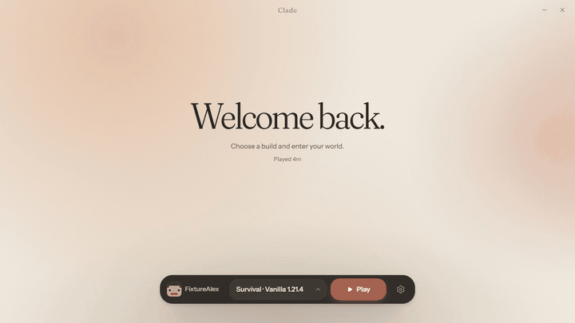
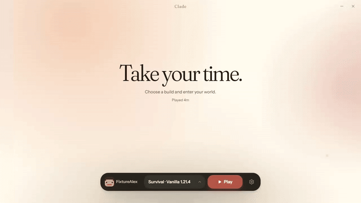

  

# Clade Launcher

**Simple. Portable. Yours.**

Clade is a clean, portable launcher for **Minecraft: Java Edition** on Windows. It is about Minecraft itself: installing versions, keeping separate profiles and starting the game. It has no store, no feeds and no built-in content marketplace.

## Why Clade?

- **Fully portable.** There is no installer. Everything Clade manages lives in one folder you can move or carry with you.
- **Vanilla first.** A plain Minecraft profile stays plain. Mods are optional, and you add them yourself.
- **Separate profiles.** Each profile has its own worlds, settings and mods, so one never affects another.
- **Vanilla, Fabric, Forge, NeoForge and Quilt.** Pick any Minecraft version, then choose a loader if you want one.
- **More than one account.** Switch between Microsoft accounts without touching your profiles.
- **Java taken care of.** Clade downloads the right Java for each version and keeps it inside its own folder.
- **Checks and repairs itself.** If a file is missing or damaged, Clade finds it and fixes it.
- **English and Русский.** Switch the language at any time.
- **Quiet.** No advertising, no news feed and no mod marketplace.

## One launcher, many profiles

A profile is one Minecraft setup: a version, its worlds, its settings and, if you like, its mods.

Create a **Vanilla** profile for any Minecraft version Mojang has published, from the newest release back to the old betas. Or create a **Modded** profile and choose Fabric, Forge, NeoForge or Quilt. Clade installs the version and the loader for you. The mods themselves are yours to add: Clade never downloads or manages them.

Profiles are completely separate. Keeping a heavily modded world next to a clean Vanilla one is safe.

## Your accounts, independent from your worlds

Add as many Microsoft accounts as you like and switch between them from the bar at the bottom of the window. An account is not tied to a profile, so the same profile can be played with any of your accounts. Switching never changes your worlds, settings or playtime.

You sign in on Microsoft's own page in your browser. Clade never sees your password. There is no cracked, guest or offline mode.

## Truly portable

Download Clade, extract it and run it. Everything it manages, from your profiles and accounts to the Java it downloads, stays in its own folder. Move that folder to another drive, a USB stick or another compatible Windows PC and carry on where you stopped.

There is no installer, and Clade does not need Java, a global `.minecraft` folder or administrator rights.

## English & Русский

Clade speaks English and Russian. Change the language in Settings and the whole window switches at once. On first start it follows your Windows language.

## Project status

Clade is in active pre-release development.

Implemented today: creating profiles, preparing Minecraft, Java and loaders, checking and repairing files, Microsoft sign-in with your Minecraft skin as your avatar, launching the game, removing a profile from Clade without deleting its files, and the English and Russian interface.

Sign-in and launching have been verified with a real Minecraft account on a development PC, for Vanilla (modern and 1.12.2), Fabric, Forge, NeoForge and Quilt. The Windows executable is not code-signed yet, so Windows may warn about it, and the clean-machine validation of a release package is still to do. There is no stable release.

## Download

No public build has been released yet.

The first portable preview will be published in [GitHub Releases](https://github.com/uoon34232/clade-launcher/releases) once the release package has passed clean-machine testing.

## Documentation

- [Technical documentation](docs/TECHNICAL.md): how Clade works and how to build it
- [Releasing](docs/RELEASE.md): how the portable package is built and verified
- [Windows QA](docs/QA-WINDOWS.md): how a package is validated on a clean machine
- [Contributing](CONTRIBUTING.md)
- [Security policy](SECURITY.md)
- [Changelog](CHANGELOG.md)
- [Brand direction](docs/BRANDING.md)

## License

Clade Launcher is licensed under the [Apache License 2.0](LICENSE).

Clade Launcher is an independent project. It is not affiliated with, endorsed by or sponsored by Mojang Studios or Microsoft. Minecraft and related marks belong to their respective owners.
