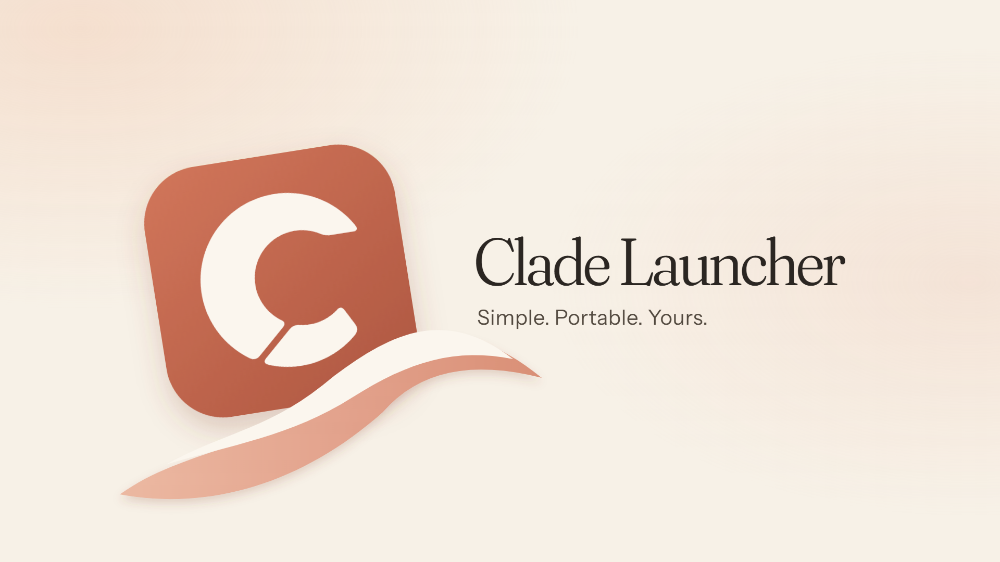
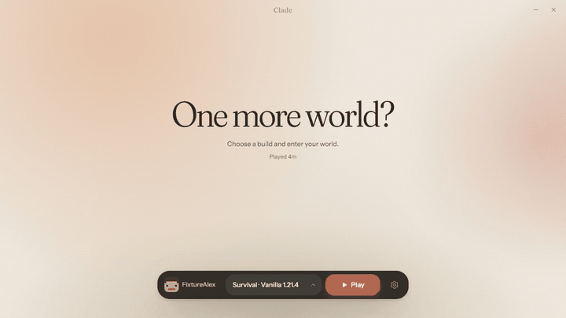
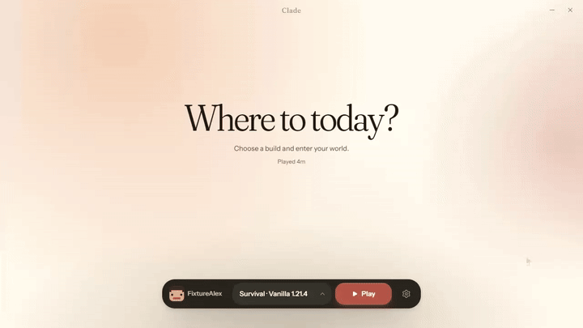

<p align="center">
  
</p>

# Clade Launcher

**Simple. Portable. Yours.**

[](https://github.com/uoon34232/clade-launcher/actions/workflows/ci.yml)

Clade is a clean, portable launcher for **Minecraft: Java Edition** on Windows. It is about Minecraft itself: installing versions, keeping separate profiles and starting the game. It has no store, no feeds and no built-in content marketplace.

<p align="center"></p>

## Why Clade?

- **Fully portable.** There is no installer. Everything Clade manages lives in one folder you can move or carry with you.
- **Vanilla first.** A plain Minecraft profile stays plain. Mods are optional, and you add them yourself.
- **Separate profiles.** Each profile has its own worlds, settings and mods, so one never affects another.
- **Vanilla, Fabric, Forge, NeoForge and Quilt.** Pick any Minecraft version, then choose a loader if you want one.
- **More than one account.** Switch between Microsoft accounts without touching your profiles.
- **Java taken care of.** Clade downloads the right Java for each version and keeps it inside its own folder.
- **Checks and repairs itself.** If a file is missing or damaged, Clade finds it and fixes it.
- **English and Русский.** Switch the language at any time.
- **Quiet.** No advertising, no news feed and no mod marketplace.

## One launcher, many profiles

A profile is one Minecraft setup: a version, its worlds, its settings and, if you like, its mods.

Create a **Vanilla** profile for any Minecraft version Mojang has published, from the newest release back to the old betas. Or create a **Modded** profile and choose Fabric, Forge, NeoForge or Quilt. Clade installs the version and the loader for you. The mods themselves are yours to add: Clade never downloads or manages them.

Profiles are completely separate. Keeping a heavily modded world next to a clean Vanilla one is safe. Each profile can be renamed at any time without moving or renaming its folder, switched to another Minecraft or compatible loader version in place while keeping its worlds and options, duplicated into a separate copy before trying an update, and opened straight to its `game/` folder from Clade. Clade opens in a calm **Simple** mode by default; switching to **Advanced** mode in Settings unlocks snapshot/historical version filters, manual loader version selection, and per-profile game memory, initial window size, and allowlisted JVM flags. If a folder inside `instances/` ever has a damaged or unreadable `instance.json`, Clade leaves its files untouched and shows a warning so it never disappears silently while your other profiles keep working. Removing a profile from Clade moves its folder into `instances/.removed/` without deleting anything, and you can restore it in one click at any time.

<p align="center"></p>

## Your accounts, independent from your worlds

Add as many Microsoft accounts as you like and switch between them from the bar at the bottom of the window. An account is not tied to a profile, so the same profile can be played with any of your accounts. Switching never changes your worlds, settings or playtime.

You sign in on Microsoft's own page in your browser. Clade never sees your password. There is no cracked, guest or offline mode.

Your saved sign-ins are encrypted with a passphrase you choose, and it cannot be recovered. If you forget it, choose **Forgot passphrase?** on the unlock screen, then **Start fresh**: Clade archives the old encrypted store inside its own folder (`data/retired-vaults/`, nothing is deleted) and you sign in to your accounts again with a new passphrase. Your profiles, worlds, playtime and settings are kept. Starting fresh does not sign you out at Microsoft. Once you have signed in again, you can delete old archived stores from Settings -> Support.

<p align="center"></p>

## Truly portable

Download Clade, extract it and run it. Everything it manages, from your profiles and accounts to the Java it downloads, stays in its own folder. Move that folder to another drive, a USB stick or another compatible Windows PC and carry on where you stopped.

There is no installer, and Clade does not need Java, a global `.minecraft` folder or administrator rights.

## English & Русский

Clade speaks English and Russian. Change the language in Settings and the whole window switches at once. On first start it follows your Windows language.

<p align="center"></p>

## Project status

Clade is in active pre-release development.

Implemented today: creating, renaming and duplicating profiles, switching Minecraft or loader versions in place, Simple and Advanced interface modes, per-profile memory, window size and allowlisted JVM flags, opening a profile's `game/` folder, preparing Minecraft, Java and loaders, checking and repairing files, Microsoft sign-in with your Minecraft skin as your avatar, changing your skin and capes, launching the game (framed inside Clade, with Clade kept open, or with Clade hidden), removing a profile without deleting its files and restoring removed profiles in one click, surfacing unreadable profile folders as warnings without touching their files, clearing archived sign-in vaults with confirmation, manual update checking in Settings, and the English and Russian interface.

Sign-in, Java provisioning, launching and zero-footprint portability have been verified with a real Microsoft/Minecraft account on Windows 11 x64, covering Vanilla (modern and 1.12.2), Fabric, Forge, NeoForge and Quilt. The Windows executable is not code-signed yet, so Windows may warn about it, and there is no stable `1.0` release yet.

## Download

Download **`Clade-Launcher-Portable.zip`** from **[GitHub Releases](https://github.com/uoon34232/clade-launcher/releases)** (current pre-release: [`v0.1.0-preview.4`](https://github.com/uoon34232/clade-launcher/releases/tag/v0.1.0-preview.4)), extract the `Clade-Launcher` folder to any normal folder or USB drive, and run `Clade.exe`.

To verify the download in PowerShell against the `.sha256` file published next to the ZIP:

```powershell
(Get-FileHash .\Clade-Launcher-Portable.zip -Algorithm SHA256).Hash.ToLower()
Get-Content .\Clade-Launcher-Portable.zip.sha256
```

## Requirements

- **Windows 10 (64-bit) and Windows 11 (64-bit) (`x64`).**
- Nothing to install: extract the ZIP to a normal folder and run `Clade.exe`. No administrator rights are needed.
- **Windows 10 notes:** on an NTFS folder, Clade automatically grants the AppContainer read-and-execute permissions its bundled WebView2 runtime needs on `runtimes/webview2/` (using Win32 security APIs, without administrator rights). FAT32 and exFAT drives cannot store those permissions, so on Windows 10 Clade falls back to the PC's installed Evergreen WebView2 runtime on those drives; prefer NTFS for a removable drive meant for a clean Windows 10 PC that might not have WebView2 installed. Where Windows 11 uses the DWM Mica window backdrop, Windows 10 uses Clade's warm opaque paper window look.

## The Preview is not code-signed

Clade Preview is not code-signed. Windows may therefore treat `Clade.exe` with suspicion:

- **SmartScreen** may show a warning before it starts.
- **Smart App Control**, when Windows 11 runs it in enforcement mode, may block `Clade.exe` completely, and it may offer no "Run anyway" option.

Please do not disable or bypass Smart App Control, Defender or any other Windows security feature to run Clade.

## Reporting bugs

[Report a bug](https://github.com/uoon34232/clade-launcher/issues/new/choose) in GitHub Issues. Say which Clade and Windows version you use, what happened and how to reproduce it. Never post passwords, Microsoft sign-in codes, tokens, callback addresses or vault files. Security problems go through [SECURITY.md](SECURITY.md) instead.

## Documentation

- [Technical documentation](docs/TECHNICAL.md): how Clade works and how to build it
- [Releasing](docs/RELEASE.md): how the portable package is built and verified
- [Windows QA](docs/QA-WINDOWS.md): how a package is validated on a clean machine
- [Contributing](CONTRIBUTING.md)
- [Security policy](SECURITY.md)
- [Changelog](CHANGELOG.md)
- [Brand direction](docs/BRANDING.md)

## License

Clade Launcher is licensed under the [Apache License 2.0](LICENSE).

Clade Launcher is an independent project. It is not affiliated with, endorsed by or sponsored by Mojang Studios or Microsoft. Minecraft and related marks belong to their respective owners.
